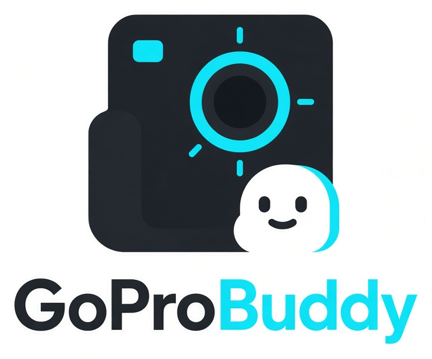
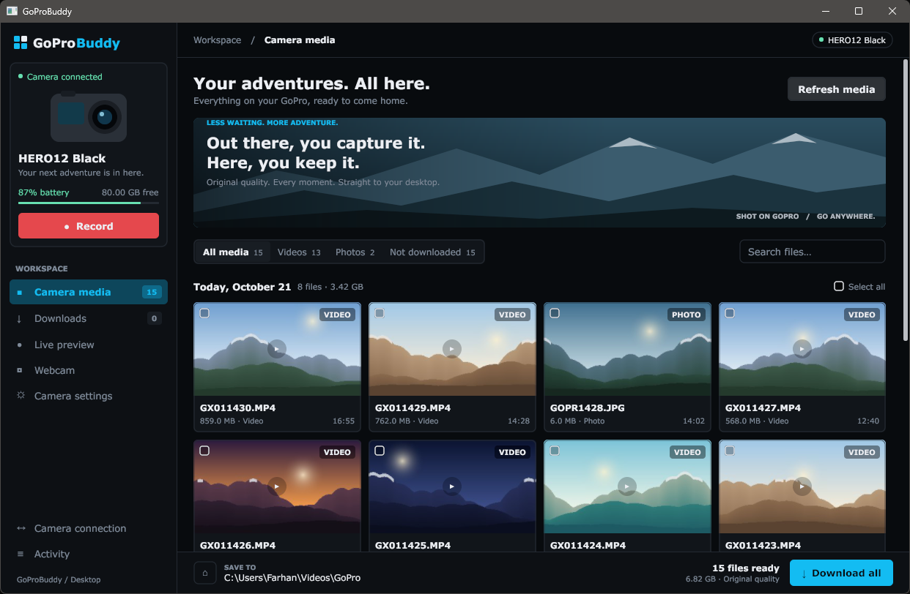
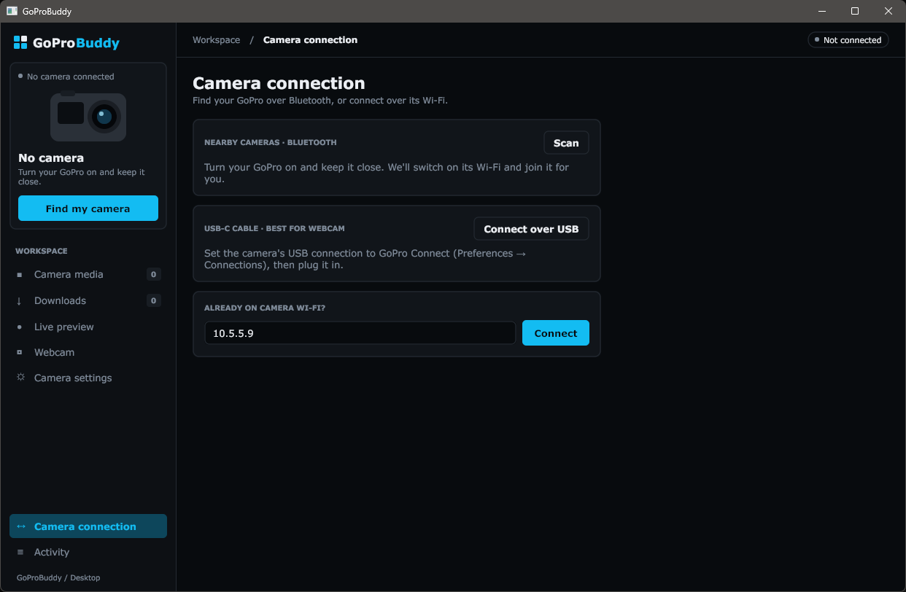
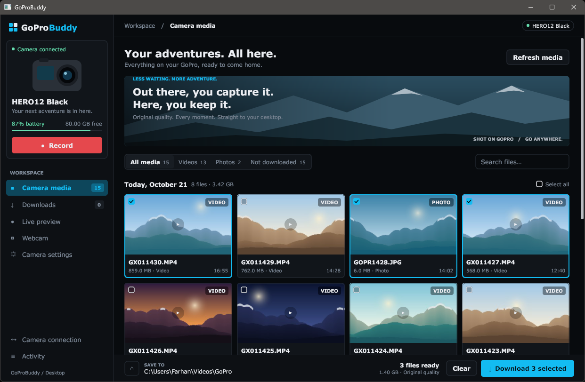
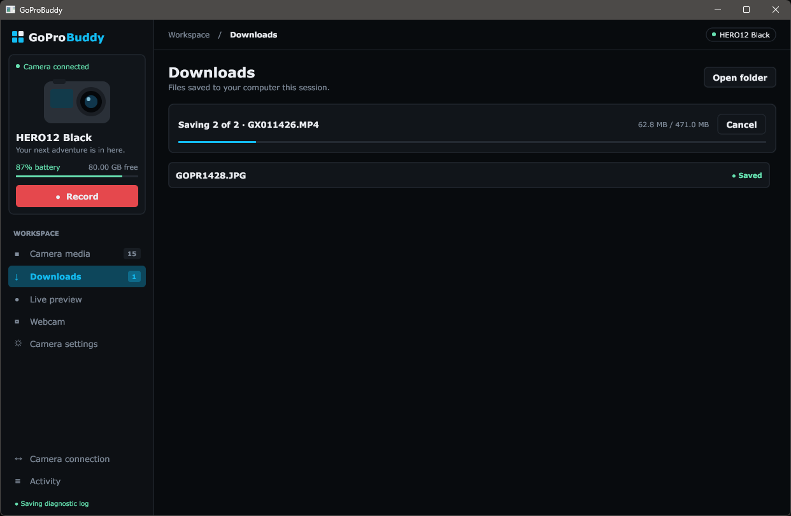
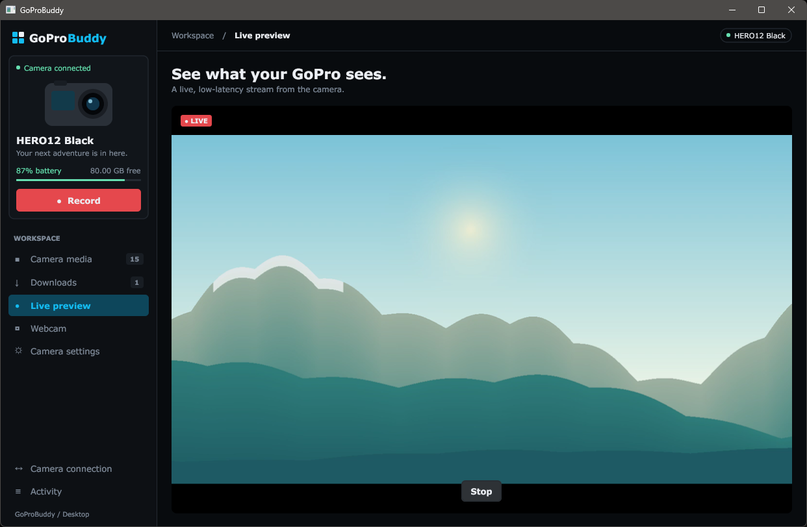
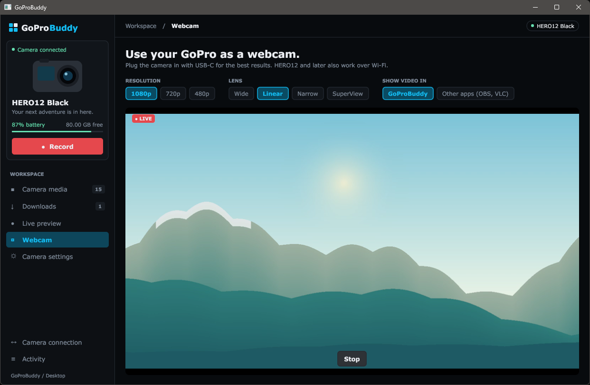
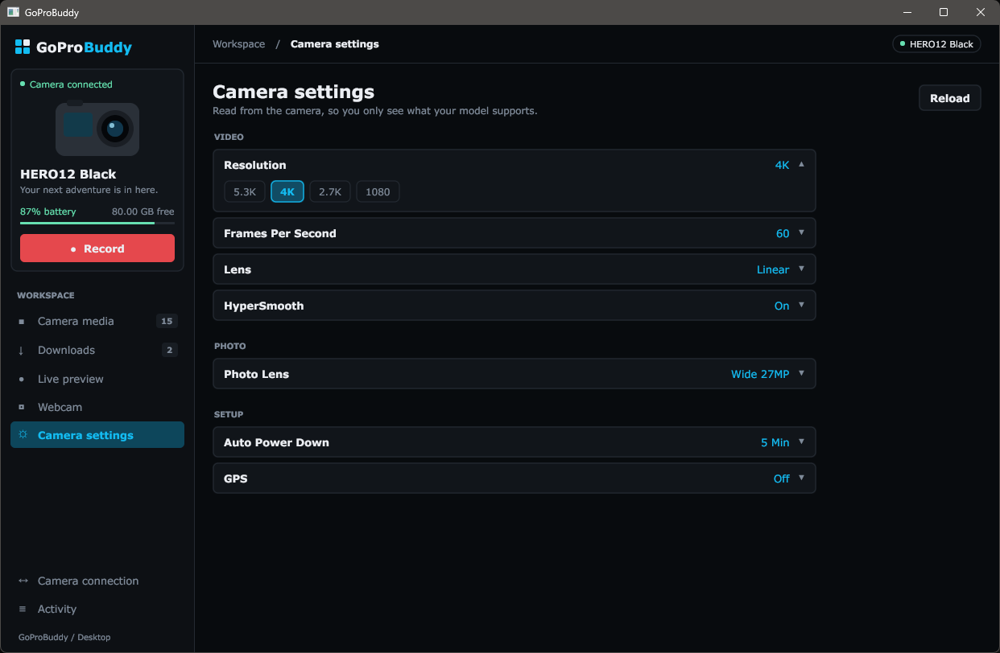
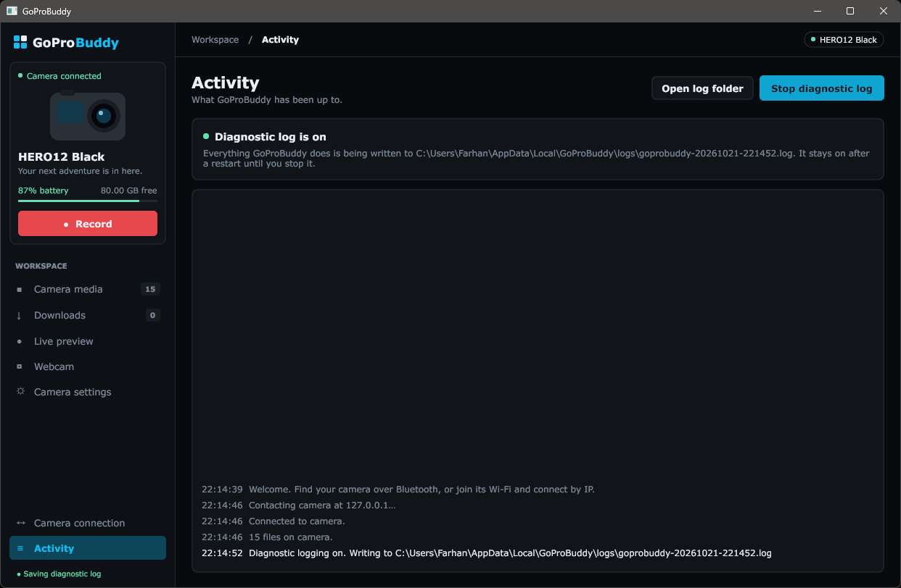

<div align="center">



**Your GoPro, on your desktop.** Find the camera, pull every clip off it in original quality, watch it live, use it as a webcam, and change its settings, all from one native desktop app for Windows, macOS and Linux.


[](https://github.com/shariorfarhan07/GoProBuddy/actions/workflows/build.yml)


[](LICENSE)



</div>

> [!WARNING]
> **This is a preview release.** It works, but it has only been tried on a handful of cameras. Expect rough edges. If something breaks, please [open an issue](#reporting-a-problem). A diagnostic log makes bugs much faster to fix.

---

## Contents
- [Why GoProBuddy?](#why-goprobuddy)
- [Features](#features)
- [Getting started](#getting-started)
- [Camera support](#camera-support)
- [Debugging](#debugging)
- [Reporting a problem](#reporting-a-problem)
- [Building from source](#building-from-source)
- [Project layout](#project-layout)
- [FAQ](#faq)
- [Contributing](#contributing)
- [License](#license)

## Why GoProBuddy?
GoPro's own app is built for phones. On a PC you're left with card readers and USB file browsing. GoProBuddy uses GoPro's public [Open GoPro](https://gopro.github.io/OpenGoPro/) API, over Bluetooth and the camera's own Wi-Fi, so you can leave the SD card in the camera.

- **Native and light.** It's a single small program written in Go, on Windows, macOS and Linux. There's no Electron and no web view.
- **Original quality.** Files are copied byte for byte, with no re-encoding.
- **Private.** No account and no cloud. Everything stays between your camera and your PC.

## Features

### Connect your camera, three ways


| Method | What happens |
|---|---|
| **Bluetooth** (Scan) | GoProBuddy finds nearby GoPros, pairs with them, switches on the camera's Wi-Fi and **joins it for you**. |
| **USB-C** (Connect over USB) | GoProBuddy detects a camera plugged in by cable automatically. This is the best option for webcam mode. |
| **Wi-Fi by IP** | If your PC is already on the camera's Wi-Fi, type its address (usually `10.5.5.9`) and press Connect. |

Once you're connected, the sidebar card shows the camera model, battery, free SD space and a **Record** button. GoProBuddy keeps the camera awake while you work.

### Browse everything on the card


- Thumbnails for every photo and video, **grouped by day** with a file count and total size for each day
- Filters: **All media · Videos · Photos · Not downloaded**, plus search by file name
- Files that are already on your PC are marked **● Saved**

### Pick what you want, or take everything


Click cards to select them, or use **Select all**. The bar at the bottom shows how many files are ready and their total size. **Download N selected** saves your picks; with nothing selected, **Download all** saves everything not yet on your PC.

### Downloads that don't give up


- Saves to `Videos\GoPro` by default. Change the folder in the **Save to** box, or click the folder button to open it.
- **Resumes** interrupted downloads instead of starting over, and skips files you already have.
- Turns on the camera's **turbo transfer** mode while it copies.
- Keeps each file's original date, so your photo library sorts it correctly.

### Live preview


A low-latency live view from the camera. It's handy for framing a shot when the camera is mounted somewhere awkward. *Needs [FFmpeg](#requirements).*

### Use your GoPro as a webcam


- Choose the **resolution** (1080p, 720p, 480p) and the **lens** (Wide, Linear, Narrow, SuperView).
- **Show video in GoProBuddy** to watch it in the app, or **Other apps (OBS, VLC)**, which sends the stream to `udp://@:8554` for another program to open.
- To use it in Zoom, Teams or Meet: in OBS, add a *Media Source* with that address (untick *Local File*), then click **Start Virtual Camera**.

### Camera settings


GoProBuddy **asks the camera which settings it supports**, so you see exactly what your model and firmware offer: resolution, frame rate, lens, stabilization, auto power-off, GPS and more. Click a setting to see its choices, then click one to apply it. If the camera refuses a combination (for example a frame rate the current resolution can't do), the reason appears under Activity.

### Activity and diagnostic log


Activity shows every step in plain language. **Start diagnostic log** writes a detailed log file you can attach to a bug report. See [Debugging](#debugging).

> Screenshots were taken against a simulated camera, so the thumbnails and file names are sample data.

## Getting started

### Requirements
| | Windows | macOS | Linux |
|---|---|---|---|
| System | Windows 10 or 11 | macOS 11 Big Sur or later (Intel or Apple Silicon) | A desktop with **NetworkManager** and **BlueZ** (Ubuntu, Fedora, Debian, Mint …) |
| Connection | Bluetooth + Wi-Fi, or USB-C | Bluetooth + Wi-Fi, or USB-C | Bluetooth + Wi-Fi, or USB-C |
| FFmpeg (only for Live preview and watching the webcam in the app) | `winget install Gyan.FFmpeg` | `brew install ffmpeg` | `sudo apt install ffmpeg` (or your distro's package) |

You can also put the `ffmpeg` program next to GoProBuddy.

### Install
Download the file for your system from [Releases](../../releases):

| System | File | How to install |
|---|---|---|
| **Windows** | `GoProBuddy-windows-amd64.zip` (`arm64` for Snapdragon PCs) | Unzip and run `GoProBuddy.exe`. If SmartScreen warns you, click *More info → Run anyway*. |
| **macOS** | `GoProBuddy-macos.zip` (one app for Intel and Apple Silicon) | Unzip and drag **GoProBuddy** to *Applications*. The first time, **right-click → Open**, because the app isn't notarized yet. Allow Bluetooth when macOS asks. |
| **Linux** | `GoProBuddy-linux-amd64.tar.gz` (`arm64` for ARM) | `tar xzf GoProBuddy-linux-*.tar.gz && ./GoProBuddy-linux-*/install.sh`, then start GoProBuddy from your app menu. |

Or [build it yourself](#building-from-source).

### First run
1. Start GoProBuddy.
2. Turn on your GoPro. **The first time only**, put it in pairing mode: *Preferences → Wireless Connections → Connect Device*.
3. Click **Find my camera**, then **Connect** next to your camera. GoProBuddy pairs, switches on the camera's Wi-Fi and joins it.
4. Open **Camera media**, select files and click **Download**.

> [!NOTE]
> While your computer is on the camera's Wi-Fi it has **no internet over Wi-Fi**. That's how GoPro's Wi-Fi works. Use Ethernet or USB-C if you need both at once.

## Camera support
GoProBuddy uses GoPro's documented HTTP API (with a fallback for older cameras), so most cameras from HERO9 onward should work.

| | HERO9–HERO11 | HERO12 and later | Older (HERO5–8) |
|---|---|---|---|
| Bluetooth connect, media, download, preview | expected | expected | legacy API fallback, untested |
| Webcam | Wi-Fi (tested on HERO9) or USB-C | Wi-Fi or USB-C | not supported |
| Settings | expected | expected | untested |

"Expected" means the feature uses the API GoPro documents for that model; it doesn't mean we've tested it on every camera. This is a preview, and reports from real hardware are what move a row to ✅.

*Tried it on a model that's marked untested? Please tell us in an issue, whether it worked or not.*

## Debugging

### Quick fixes
| Symptom | Try this |
|---|---|
| **Scan finds nothing** | Wake the camera, keep it within about 1 m, and make sure Bluetooth is on. On macOS, check *System Settings → Privacy & Security → Bluetooth* allows GoProBuddy. For a first connection, the camera must be in pairing mode. |
| **Bluetooth connect / pairing fails** | Remove the camera from your system's Bluetooth settings (Windows: *Settings → Bluetooth & devices*; macOS: *System Settings → Bluetooth*; Linux: `bluetoothctl remove <address>`), put the camera back in pairing mode, and connect again. |
| **"Could not join Wi-Fi automatically"** (Linux: needs NetworkManager) | Join the camera's network yourself. Activity shows its name and password. Then connect by IP (`10.5.5.9`). |
| **"Camera not reachable"** | Check that the PC really is on the camera's Wi-Fi. A VPN or firewall can block `10.5.5.9`. Pause them and try again. |
| **Thumbnails stay grey** | Click **Refresh media**. If they're still grey, start a diagnostic log and report it. |
| **Live preview / webcam shows "ffmpeg not found"** | Install FFmpeg (see [Requirements](#requirements)), or put `ffmpeg` next to GoProBuddy. |
| **Preview or webcam stays on "Waiting for video…"** | Allow GoProBuddy (and ffmpeg) through your firewall (Windows Firewall on *private* networks; on macOS, accept the incoming-connections prompt). Video arrives over UDP: port 8556 for preview, 8554 for webcam. |
| **"Webcam mode is unavailable right now"** | Make sure the camera isn't recording or in a menu, then try again. If it keeps refusing, use a USB-C cable: set the camera's *USB Connection* to *GoPro Connect* and plug it in. GoProBuddy switches to the cable automatically. |
| **A setting won't change** | Some options depend on other settings, such as frame rate on resolution. Change the related setting first. |

### Diagnostic log
When something goes wrong, the diagnostic log records exactly what happened: every request to the camera, every Bluetooth step, download speeds, ffmpeg messages and crash traces.

1. Open **Activity** and click **Start diagnostic log**. The sidebar shows *● Saving diagnostic log*.
2. **Reproduce the problem.** Logging stays on after a restart, so problems during start-up are recorded too.
3. Click **Open log folder**. File Explorer opens with the newest log file selected.
4. Attach that file to your [issue](#reporting-a-problem), then click **Stop diagnostic log**.

Logs are stored in `%LOCALAPPDATA%\GoProBuddy\logs\`, and only the 10 newest files are kept. **Wi-Fi passwords are never written to the log** (only their length). The log does include your camera's Wi-Fi name, your PC's name and folder paths. Look through it before you share it if that matters to you.

Each line is tagged with the part of the app it came from. That makes the log easy to search:

```
2026-10-21 22:15:13.192 [download] queued 100GOPRO/GX011426.MP4 (493879296 bytes)
2026-10-21 22:15:13.192 [camera] turbo transfer on=true: err=<nil>
2026-10-21 22:15:13.780 [download] saved GOPR1428.JPG: 6291456 bytes in 0.6s (10.7 MB/s) -> C:\…\GoPro\GOPR1428.JPG
2026-10-21 22:15:30.176 [download] GX011426.MP4: stopped at 168296448 of 493879296 bytes: context canceled
```

| Tag | Covers |
|---|---|
| `app`, `ui`, `state` | What you clicked, messages shown in Activity, and a snapshot of the app when logging starts |
| `ble`, `pair`, `wifi`, `usb` | Bluetooth scanning, pairing, joining Wi-Fi, USB detection |
| `http`, `camera` | Every request to the camera and its answer; battery, SD card and connection changes |
| `media`, `download` | The file list from the camera, each download, speed, resume and errors |
| `stream`, `webcam`, `ffmpeg` | Live preview and webcam start-up, ffmpeg output, frame counts |
| `settings` | Reading and changing camera settings |
| `panic`, `go` | Crashes, with stack traces |

## Reporting a problem
Found a bug? Thank you! Please [open an issue](../../issues/new/choose) and choose **Bug report**. A good report has:

1. **What happened, and what you expected.** For example: *"Download stops at 40% on large videos."*
2. **Steps to reproduce**, numbered, starting from launching the app.
3. **Your setup:**
   - GoProBuddy version (the first line of the log file, or the release you downloaded)
   - Camera model and firmware (*Preferences → About*)
   - Operating system and version (Windows: `winver`; macOS: Apple menu → About This Mac; Linux: distro and version)
   - How you connected: Bluetooth, USB-C or Wi-Fi by IP
4. **The diagnostic log** from a run where the problem happened. See [Diagnostic log](#diagnostic-log). This is the most useful part.
5. **A screenshot** if the problem is something you can see.

Before you open a new issue, search the existing ones; someone may already have reported it, and a 👍 on that issue helps too. Please open one issue per problem, and never post your camera's Wi-Fi password.

Feature ideas are welcome. Choose **Feature request** and describe the problem you want solved, not only the solution.

## Building from source
You need **Go 1.27+** (see `go.mod`). Run `go test ./internal/...` to check everything works.

**Windows.** No C compiler is needed.
```powershell
go build -ldflags="-H=windowsgui -s -w -X main.appVersion=0.1.0-preview" -o GoProBuddy.exe .
```
The icon in Explorer, the title bar and the taskbar comes from the `rsrc_windows_*.syso` files, which `go build` links in automatically. If you change `assets/logo.ico`, regenerate them with `go generate`.

**macOS.** You need the Xcode command-line tools (`xcode-select --install`).
```sh
go build -ldflags="-s -w" -o GoProBuddy .
```
To use Bluetooth, the program must run as an app bundle with `packaging/macos/Info.plist`; macOS closes bare binaries that touch Bluetooth. The `macos` job in [`.github/workflows/build.yml`](.github/workflows/build.yml) shows how to make `GoProBuddy.app`.

**Linux.** Install Gio's build dependencies (Debian/Ubuntu shown):
```sh
sudo apt install gcc pkg-config libwayland-dev libx11-dev libx11-xcb-dev libxkbcommon-x11-dev \
  libgles2-mesa-dev libegl1-mesa-dev libffi-dev libxcursor-dev libvulkan-dev
go build -ldflags="-s -w" -o goprobuddy .
```

`-X main.appVersion=…` sets the version shown in the diagnostic log. If you leave it out, the version shows as `dev`.

**Releases.** GitHub Actions builds every platform on each push. Pushing a tag such as `v0.2.0` publishes a pre-release with all the downloads attached.

## Project layout
```
main.go                         The whole UI (Gio): pages, sidebar, media grid, footer
internal/gopro/client.go        HTTP API: status, media list, thumbnails, shutter, turbo
internal/gopro/download.go      Resumable downloads (port 8080, /videos/DCIM/…)
internal/gopro/preview.go       Live preview: UDP MPEG-TS -> ffmpeg -> frames
internal/gopro/webcam.go        Webcam mode and USB-C camera detection
internal/gopro/settings.go      Settings read from the camera's own definition
internal/gopro/ble.go           Bluetooth: scan, connect, Wi-Fi on, SSID/password, keep-alive
internal/gopro/pair_*.go        One-time Bluetooth pairing (Windows: WinRT, Linux: bluetoothctl, macOS: automatic)
internal/gopro/wifi_*.go        Joins the camera's Wi-Fi (Windows: netsh, macOS: networksetup, Linux: nmcli)
open_*.go                       Opens folders in Explorer / Finder / the Linux file manager
internal/diag/diag.go           The optional diagnostic log
assets/                         Logo: logo.png (README), logo-mark.png (transparent mark), logo.ico (app icon)
tools/winres/                   Packs logo.ico into rsrc_windows_*.syso (the Windows icon)
packaging/                      macOS Info.plist, Linux .desktop file and installer
.github/workflows/build.yml     Builds and releases for all three platforms
docs/PROTOCOL.md                How the camera protocol works (Open GoPro + measured on a HERO9)
```

## FAQ
**Does it work on macOS and Linux?** Yes, all features are built for both. Windows is where it has been tested with a real camera so far; macOS and Linux reports are very welcome.

**Does GoProBuddy delete anything from my camera?** No. It only reads from the SD card.

**Is this an official GoPro app?** No. GoProBuddy is an independent project and is not affiliated with or endorsed by GoPro, Inc. "GoPro" and "HERO" are trademarks of GoPro, Inc.

## Contributing
Contributions are welcome: bug reports, test results from cameras we haven't tried, fixes and new features. See [CONTRIBUTING.md](CONTRIBUTING.md) for how to get started.

## License
GoProBuddy is open source under the [MIT License](LICENSE). You're free to use, copy, change and share it, as long as you keep the copyright notice.

It's built on [Gio](https://gioui.org) (MIT / Unlicense) and [TinyGo Bluetooth](https://github.com/tinygo-org/bluetooth) (BSD-3-Clause). Live preview and webcam viewing use [FFmpeg](https://ffmpeg.org), which you install separately and which has its own license.
